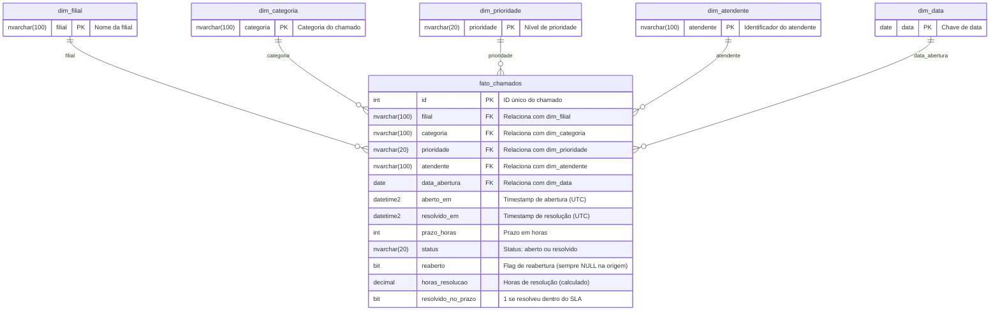

# Modelo de Dados - Diagrama Estrela

## Diagrama MERME

## Estrutura Estrela

O modelo segue a estrutura de **esquema estrela** (star schema), otimizado para consultas analíticas:

- **Fato central**: `fato_chamados` - contém as métricas e chaves estrangeiras
- **Dimensões**: 5 tabelas de dimensão fornecem atributos descritivos

### Detalhamento das Dimensões

| Dimensão | Atributos | Descrição |
|---|---|---|
| `dim_data` | `data` | Calendário contínuo (100.000 dias), cobertura completa dos anos presentes nos dados |
| `dim_filial` | `filial` | 50 filiais fictícias (`Filial 01` a `Filial 50`) |
| `dim_categoria` | `categoria` | 5 categorias: Impressora, ERP, Rede, Acesso, Hardware |
| `dim_prioridade` | `prioridade` | 4 níveis: baixa, média, alta, crítica |
| `dim_atendente` | `atendente` | Valor fixo "Não informado" (a origem não possui registro de atendente) |

### Métricas do Fato

| Campo | Tipo | Descrição |
|---|---|---|
| `id` | int | Identificador único do chamado |
| `aberto_em` | datetime2 | Timestamp da abertura (UTC) |
| `resolvido_em` | datetime2 | Timestamp da resolução (pode ser NULL) |
| `prazo_horas` | int | Prazo máximo em horas para resolução |
| `status` | nvarchar | Valores: 'aberto' ou 'resolvido' |
| `horas_resolucao` | decimal | Duração em horas (calculada via SQL) |
| `resolvido_no_prazo` | bit | 1 se resolvido dentro do SLA, 0 caso contrário |

## Regras de Negócio no Modelo

1. **SLA (Service Level Agreement)**: Um chamado é considerado dentro do prazo se:
   - Estiver resolvido e `resolvido_em <= aberto_em + prazo_horas`

2. **Chamados vencidos**: No cálculo do SLA, consideram-se:
   - Chamados resolvidos (divididos entre dentro e fora do prazo)
   - Chamados abertos que ultrapassaram o prazo em relação à referência UTC

3. **Abertos fora do prazo**: Calculados como abertos cujo prazo já expirou na referência UTC fixa

## Relacionamentos

Todos os relacionamentos são **1:muitos** (1:N) da dimensão para o fato, com **filtro unidirecional** da dimensão para o fato, permitindo:
- Filtragem eficiente pelas dimensões
- Navegação livre das dimensões ao fato
- Navegação restrita do fato às dimensões

## Observações

- A origem do projeto 4 (`painel-chamados`) não possui informação de atendente nem reabertura
- Todos os timestamps estão em UTC
- O campo `reaberto` é sempre NULL, não aplicável à esta origem